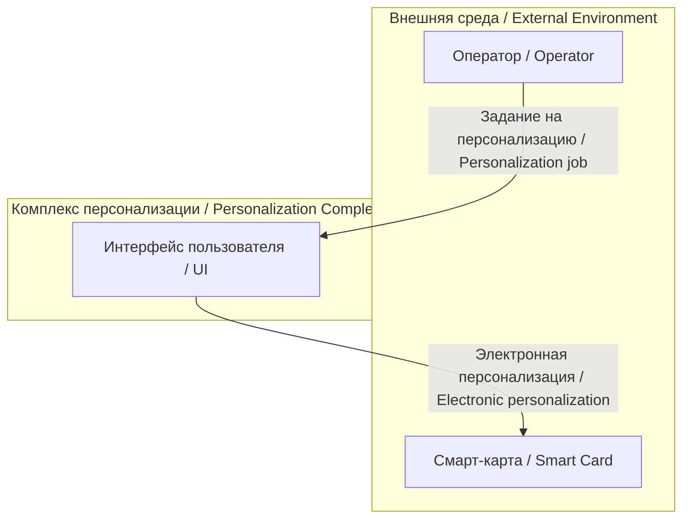
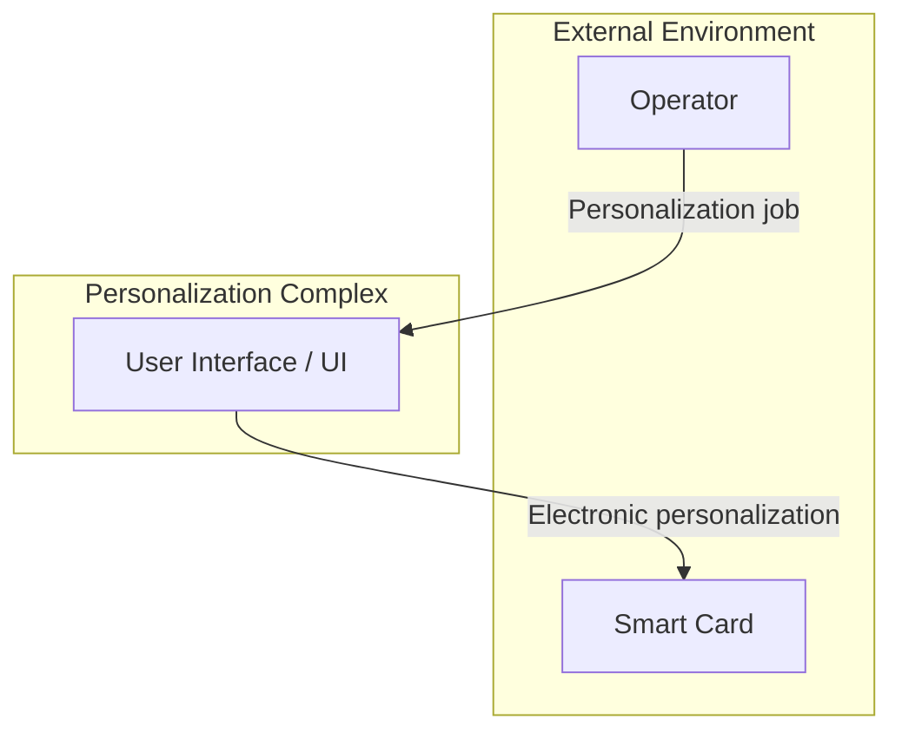
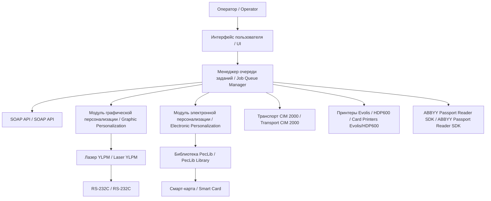
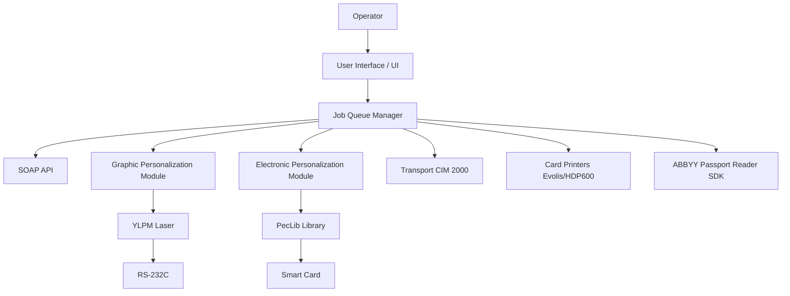
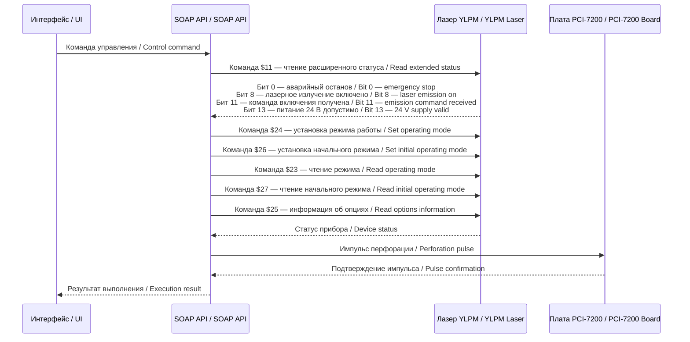
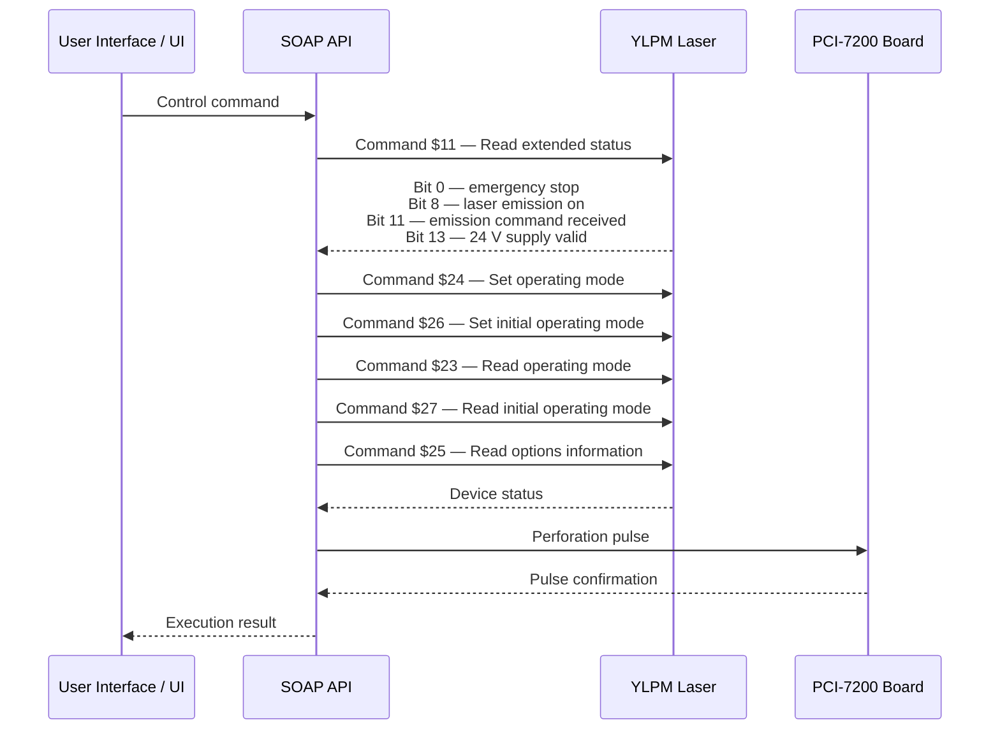
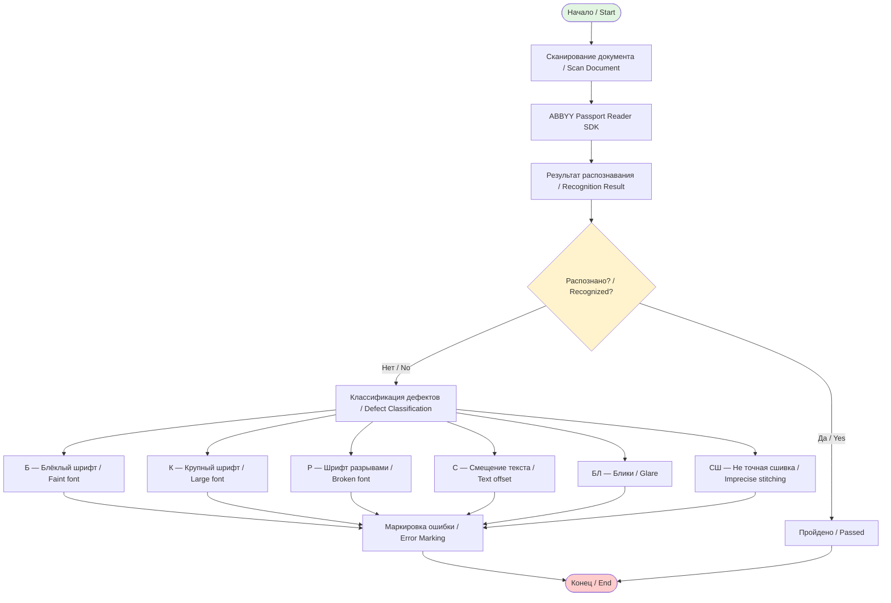
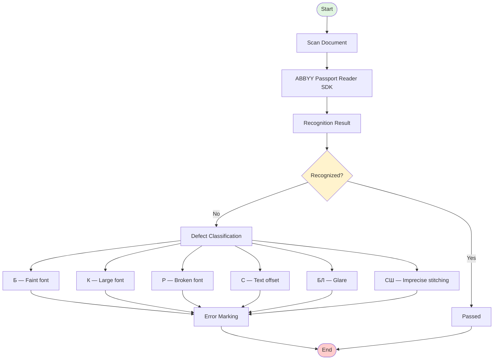

# ICAO MRTD Personalization Complex — Architecture Diagrams

**Repository:** `ekatmoz88-alt/icao-mrtd-documentation`
**Source:** Sanitized project source archive
**Status:** Draft — based exclusively on extracted source documents
**Languages:** English / Russian
**Anonymization:** All customer names, personal data, serial numbers, keys, and internal addresses replaced with placeholders.

---

## Содержание / Contents

### RU
1. [Контекстная диаграмма (C4 Context)](#1-контекстная-диаграмма-c4-context)
2. [Контейнерная диаграмма (C4 Container)](#2-контейнерная-диаграмма-c4-container)
3. [Диаграмма последовательности управления лазером YLPM](#3-диаграмма-последовательности-управления-лазером-ylpm)
4. [Диаграмма алгоритма контроля качества MRZ](#4-диаграмма-алгоритма-контроля-качества-mrz)
5. [Статистика распознавания MRZ](#5-статистика-распознавания-mrz)

### EN
1. [C4 Context Diagram](#1-c4-context-diagram)
2. [C4 Container Diagram](#2-c4-container-diagram)
3. [YLPM Laser Control Sequence Diagram](#3-ylpm-laser-control-sequence-diagram)
4. [MRZ Quality Control Algorithm Diagram](#4-mrz-quality-control-algorithm-diagram)
5. [MRZ Recognition Statistics](#5-mrz-recognition-statistics)

---

## 1. Контекстная диаграмма (C4 Context) / C4 Context Diagram

### RU
Показывает границу системы и внешних акторов: Оператор, смарт-карта, внешняя среда.

### EN
Shows the system boundary and external actors: Operator, Smart Card, external environment.

---

## 2. Контейнерная диаграмма (C4 Container) / C4 Container Diagram

### RU
Внутренняя структура системы: компоненты, их взаимодействие и интеграция с внешним оборудованием.

### EN
Internal system structure: components, their interaction, and integration with external hardware.

---

## 3. Диаграмма последовательности управления лазером YLPM / YLPM Laser Control Sequence Diagram

### RU
Порядок команд управления лазером YLPM через RS-232C и проверка битов расширенного статуса. Платы ввода/вывода PCI-7200 используются для импульсной перфорации.

### EN
Sequence of YLPM laser control commands via RS-232C and extended status bit verification. PCI-7200 I/O board is used for perforation pulse generation.

---

## 4. Диаграмма алгоритма контроля качества MRZ / MRZ Quality Control Algorithm Diagram

### RU
Анализ распознавания шрифтов MRZ с помощью ABBYY Passport Reader SDK. Статистика: 242 документа, распознано 226 (93,39%).

### EN
MRZ font recognition analysis using ABBYY Passport Reader SDK. Statistics: 242 documents, 226 recognized (93.39%).

---

## 5. Статистика распознавания MRZ / MRZ Recognition Statistics

### RU

| Параметр | Значение |
|---|---|
| Всего проанализировано документов | 242 |
| Распознано | 226 (93,39%) |
| Не распознано | 16 (6,61%) |

### EN

| Parameter | Value |
|---|---|
| Total documents analyzed | 242 |
| Recognized | 226 (93.39%) |
| Not recognized | 16 (6.61%) |

---

## Связь с документацией / Links to Documentation

- [SPECIFICATION.md](SPECIFICATION.md) — архитектурное и пользовательское описание / architectural and user specification
- [README.md](README.md) — главная страница проекта / project home page

---

*Документ подготовлен на основе извлечённых фактов без домыслов отсутствующих параметров. Все закрытые данные анонимизированы.*

*Document prepared based on extracted facts only, without guessing missing parameters. All sensitive data anonymized.*