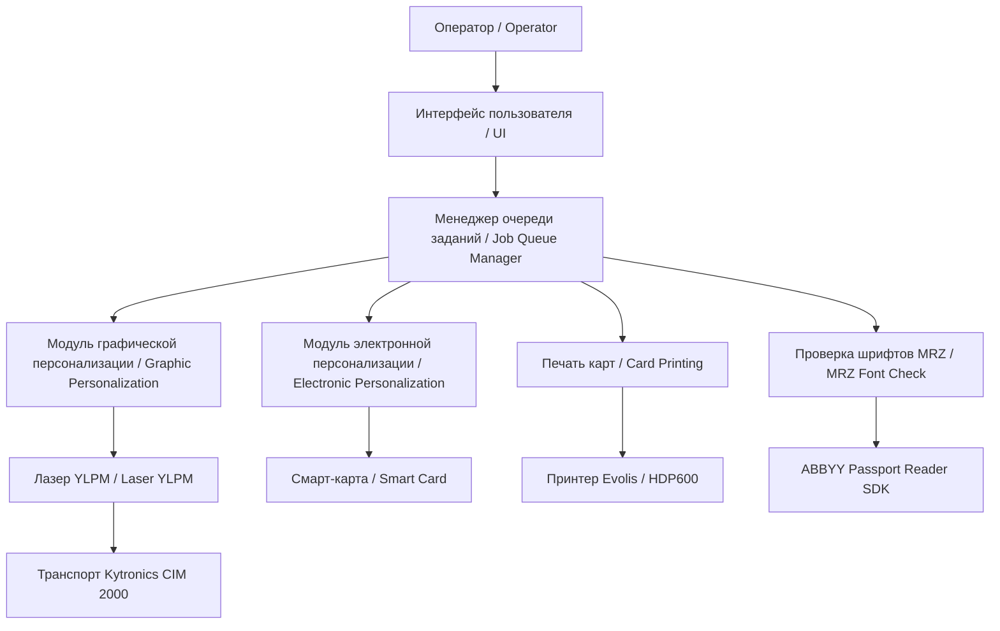
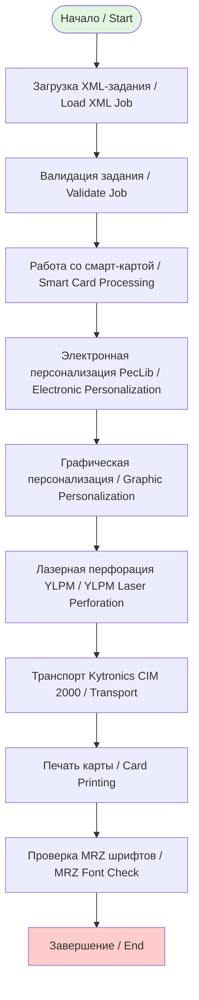
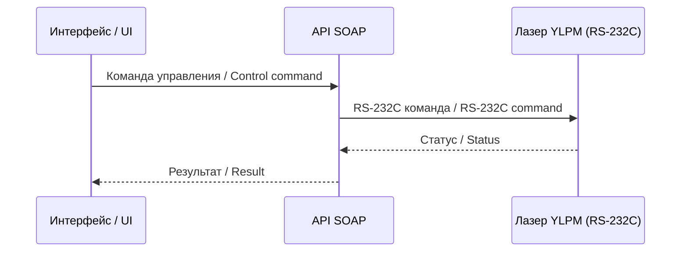
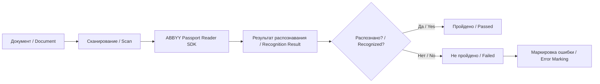

# ICAO MRTD Personalization Complex — Architectural and User Specification

**Repository:** `ekatmoz88-alt/icao-mrtd-documentation`
**Source:** Extracted from technical documentation on USB flash drive Sanitized project source archive
**Status:** Draft — based exclusively on extracted source documents
**Languages:** English / Russian
**Anonymization:** All customer names, personal data, serial numbers, keys, and internal addresses replaced with placeholders.

---

## 1. Введение / Introduction

### 1.1 Назначение документа / Purpose

**RU:** Данный документ описывает архитектуру и пользовательские требования к комплексу персонализации пластиковых карт и документов с machine-readable zone (MRZ), включая управление лазерным оборудованием, проверку шрифтов MRZ и взаимодействие с печатными устройствами.

**EN:** This document describes the architecture and user requirements for a plastic card and document personalization complex with machine-readable zone (MRZ), including laser equipment control, MRZ font verification, and interaction with printing devices.

### 1.2 Источники / Sources

| Исходный файл / Source file | Описание / Description |
|---|---|
| `Требования к программному обеспечению комплекса персонализации.docx` | Требования к ПО комплекса персонализации |
| `Проверка заполняемости шрифтов и чтения MRZ.docx` | Результаты проверки распознавания шрифтов MRZ |
| `Описание пользовательского интерфейса CardpasNet perf.docx` | Описание интерфейса станции лазерной перфорации |
| `!90917_Описание интерфейса управления приборами_YLPM_тип D-D1.doc` | Протокол управления лазером YLPM по RS-232C |
| `ТЗ на ПО управления лазером CO.doc` | Техническое задание на ПО управления лазером |
| `Evolis Card Printer.docx` | Документация принтера карт Evolis |
| `Руководство пользователя для принтеров HDP600 Series.docx` | Руководство пользователя принтера HDP600 |

---

## 2. Общие требования / General Requirements

### 2.1 Программная платформа / Software Platform

**RU:**

| Параметр | Значение |
|---|---|
| Операционная серверная ОС | ROSA Marathon [Год / Year], 32-bit, файловая система ext4 |
| Операционная ОС смарт-карт | «Магистра» (Magistral) |
| Сервер приложений | JBoss AS 6.1 |
| Среда исполнения | OpenJDK 1.6 |
| Служба смарт-карт | PCSCD v1.8.6 |
| Библиотека электронной персонализации | PecLib |

**EN:**

| Parameter | Value |
|---|---|
| Server OS | ROSA Marathon [Год / Year], 32-bit, ext4 |
| Smart card OS | Magistral |
| Application server | JBoss AS 6.1 |
| Runtime | OpenJDK 1.6 |
| Smart card service | PCSCD v1.8.6 |
| Electronic personalization library | PecLib |

### 2.2 Аппаратная платформа / Hardware Platform

**RU:** Платформа IBM PC-совместимого ПК. Поддерживаемые архитектуры: x86 (32-bit), x64 (64-bit). Требуется плата цифрового ввода/вывода ADlink PCI-7200.

**EN:** IBM PC-compatible platform. Supported architectures: x86 (32-bit), x64 (64-bit). ADlink PCI-7200 digital I/O board required.

### 2.3 Электропитание / Power Supply

**RU:** Электрическая розетка 220 В с заземлением. Требуется источник бесперебойного питания (UPS).

**EN:** 220 V electrical outlet with grounding. UPS required.

---

## 3. Архитектура системы / System Architecture

### 3.1 Компоненты / Components

### 3.2 Взаимодействие с устройствами / Device Interaction

**RU:** Управление лазером YLPM-1-4x200-20-20 осуществляется по протоколу RS-232C. Управление транспортом Kytronics CIM 2000 — через порт RS-232. Работа со считывателем смарт-карт — через службу PCSCD v1.8.6. Печать — через подключенные принтеры карт.

**EN:** YLPM-1-4x200-20-20 laser control via RS-232C protocol. Kytronics CIM 2000 transport via RS-232 port. Smart card reader via PCSCD v1.8.6 service. Printing via connected card printers.

---

## 4. Требования к программному обеспечению / Software Requirements

### 4.1 Функциональные требования / Functional Requirements

**RU:**

| ID | Требование |
|---|---|
| FR-01 | Управление очередью заданий на персонализацию |
| FR-02 | Параллельное выполнение электронной и графической персонализации |
| FR-03 | Формат заданий — XML, содержащий данные для графической и электронной персонализации |
| FR-04 | Поддержка фотографии владельца в формате JPEG 2000 |
| FR-05 | Графические объекты: изображение, текст, QR-код, круговой текст |
| FR-06 | Электронная персонализация через библиотеку PecLib |
| FR-07 | Управление лазером YLPM по RS-232 |
| FR-08 | Управление транспортом Kytronics CIM 2000 по RS-232 |
| FR-09 | Проверка шрифтов MRZ с помощью ABBYY Passport Reader SDK |
| FR-10 | API управления прибором по протоколу SOAP |

**EN:**

| ID | Requirement |
|---|---|
| FR-01 | Personalization job queue management |
| FR-02 | Parallel electronic and graphical personalization |
| FR-03 | Job format — XML with data for graphical and electronic personalization |
| FR-04 | Card owner photo in JPEG 2000 format |
| FR-05 | Graphic objects: image, text, QR-code, circular text |
| FR-06 | Electronic personalization via PecLib library |
| FR-07 | YLPM laser control via RS-232 |
| FR-08 | Kytronics CIM 2000 transport control via RS-232 |
| FR-09 | MRZ font verification via ABBYY Passport Reader SDK |
| FR-10 | Device control API via SOAP protocol |

### 4.2 Нефункциональные требования / Non-Functional Requirements

**RU:** ОС Windows XP/Vista/7 для клиентской части. Платформа .NET Framework 4.0+. Поддержка x86 и x64.

**EN:** Windows XP/Vista/7 for client part. .NET Framework 4.0+. x86 and x64 support.

---

## 5. Управление лазерным оборудованием / Laser Equipment Control

### 5.1 Лазер YLPM / YLPM Laser

**RU:** Лазер YLPM-1-4x200-20-20 управляется через последовательный порт RS-232C. Доступны команды управления режимами, чтения статуса и настройки опций.

**EN:** YLPM-1-4x200-20-20 laser controlled via RS-232C serial port. Commands available for mode control, status reading, and option configuration.

### 5.2 Основные команды / Main Commands

**RU:**

| Команда | Описание |
|---|---|
| `$11` | Чтение расширенного статуса прибора |
| `$23` | Чтение режима работы |
| `$27` | Чтение начального режима работы |
| `$24` | Установка режима работы |
| `$26` | Установка начального режима работы |
| `$25` | Чтение информации об установленных опциях |

**EN:**

| Command | Description |
|---|---|
| `$11` | Read extended device status |
| `$23` | Read operating mode |
| `$27` | Read initial operating mode |
| `$24` | Set operating mode |
| `$26` | Set initial operating mode |
| `$25` | Read installed options information |

### 5.3 Биты расширенного статуса / Extended Status Bits

**RU:** Бит 0 — аварийный останов. Бит 8 — лазерное излучение включено. Бит 11 — команда включения излучения получена по RS-232C. Бит 13 — напряжение питания 24 В допустимое.

**EN:** Bit 0 — emergency stop. Bit 8 — laser emission on. Bit 11 — emission on command received via RS-232C. Bit 13 — 24 V supply voltage valid.

### 5.4 ТЗ на ПО управления лазером / Laser Control Software TZ

**RU:** Разработка ПО для экспериментов по сверлению отверстий в пластике лазером. Импульсы длительностью 5–500 мкс, частота повторения 5 кГц–0,5 Гц, амплитуда 6,5–9 В. Управление через плату ADlink PCI-7200.

**EN:** Software development for laser drilling experiments in plastic. Pulse duration 5–500 µs, repetition frequency 5 kHz–0.5 Hz, amplitude 6.5–9 V. Control via ADlink PCI-7200 board.

### 5.5 Параметры серии импульсов / Pulse Series Parameters

**RU:**

| Параметр | Описание |
|---|---|
| Длительность импульса | мкс, диапазон 5–500 |
| Период импульсов | мкс |
| Задержка перед запуском серии | мкс |
| Количество импульсов | в последовательности |
| Количество повторений | 1–10000 или бесконечно |

**EN:**

| Parameter | Description |
|---|---|
| Pulse duration | µs, range 5–500 |
| Pulse period | µs |
| Delay before series start | µs |
| Number of pulses | in sequence |
| Number of repetitions | 1–10000 or infinite |

### 5.6 Режимы выполнения / Execution Modes

**RU:**

1. **Список серий** — задание выполняется заданное число повторений (1–10000).
2. **Бесконечное повторение** — выполняется неограниченно до нажатия кнопки «Стоп».

**EN:**

1. **Series list** — task executed for a specified number of repetitions (1–10000).
2. **Infinite repetition** — executed indefinitely until user presses «Stop».

### 5.7 Формат файла задания / Task File Format

**RU:** XML. Чтение/запись задания в файл XML.

**EN:** XML. Read/write task to XML file.

---

## 6. Пользовательский интерфейс / User Interface

### 6.1 Станция лазерной перфорации CardpasNet / CardpasNet Laser Perforation Station

**RU:** Программное обеспечение для управления заданием на макете технологической установки лазерной перфорации. Интерфейс включает панели: Инструментов, Объектов, Свойств, Персонализации, Информации, Тестов, Направляющих, Порядка элементов.

**EN:** Software for managing perforation station layout tasks. UI panels: Tools, Objects, Properties, Personalization, Info, Tests, Guides, Element Order.

### 6.2 Объекты персонализации / Personalization Objects

**RU:** Изображение перфорированное, текст перфорации, векторное изображение.

**EN:** Perforated image, perforation text, vector image.

### 6.3 Настройки сканеров / Scanner Settings

**RU:** Окна настроек: Сканаторы, Поле сканаторов, Коррекция сканаторов, Движение сканаторов, Лазер, Устройства, Оси, COM порты, Устройства вывода, Плату PCI-7200, Контроллер Ethernet, Вид, Обработка изображения, Лэйаут, Импорт, Объекты перфорации.

**EN:** Settings windows: Scanners, Scanner Field, Scanner Correction, Scanner Movement, Laser, Devices, Axes, COM Ports, Output Devices, PCI-7200 Board, Ethernet Controller, View, Image Processing, Layout, Import, Perforation Objects.

---

## 7. Проверка шрифтов MRZ / MRZ Font Verification

### 7.1 Методология / Methodology

**RU:** Анализ распознавания шрифтов заполняемых данных и шрифтов MRZ в анализаторе документов «Диспетчер» с помощью ABBYY Passport Reader SDK.

**EN:** Analysis of filled data font and MRZ font recognition in «Dispatcher» document analyzer using ABBYY Passport Reader SDK.

### 7.2 Обозначения проблем / Issue Markers

**RU:**

| Обозначение | Значение |
|---|---|
| Б | Блёклый шрифт |
| К | Крупный шрифт |
| Р | Шрифт разрывами |
| ? | Качественный шрифт |
| С | Смещение текста |
| БЛ | Блики |
| СШ | Не точная сшивка |

**EN:**

| Marker | Meaning |
|---|---|
| Б | Faint font |
| К | Large font |
| Р | Broken font |
| ? | Good quality font |
| С | Text offset |
| БЛ | Glare |
| СШ | Imprecise stitching |

### 7.3 Статистика / Statistics

**RU:** Всего проанализировано документов: 242. Распознано: 226 (93,39%). Не распознано: 16 (6,61%).

**EN:** Total documents analyzed: 242. Recognized: 226 (93.39%). Not recognized: 16 (6.61%).

---

## 8. Печатные устройства / Printing Devices

### 8.1 Принтеры карт / Card Printers

**RU:** Поддерживаются принтеры серии HDP600 и Evolis Card Printer. Используются для печати и персонализации пластиковых карт.

**EN:** HDP600 series and Evolis Card Printer supported. Used for printing and personalizing plastic cards.

---

## 9. Анонимизация / Anonymization

**RU:** Все названия заказчиков, ФИО, серийные номера, ключи и внутренние адреса заменены на обобщённые обозначения.

**EN:** All customer names, personal data, serial numbers, keys, and internal addresses replaced with placeholders.

---

## 10. Извлечённые файлы и изображения / Extracted Files and Images

**RU:** Изображения и схемы сохранены в папке `/tmp/usb_schemes_mrtd/`. Всего извлечено изображений: 268.

**EN:** Images and diagrams saved to `/tmp/usb_schemes_mrtd/`. Total images extracted: 268.

### 10.1 Список основных изображений / Main Image List

**RU:** Изображения включают скриншоты интерфейса CardpasNet, схемы подключения оборудования, иллюстрации из руководств принтеров Evolis и HDP600.

**EN:** Images include CardpasNet UI screenshots, equipment connection schematics, illustrations from Evolis and HDP600 printer guides.

---

## 11. Mermaid Диаграммы / Mermaid Diagrams

### 11.1 Процесс персонализации карты / Card Personalization Process

### 11.2 Управление лазером / Laser Control Flow

### 11.3 Проверка MRZ / MRZ Verification Flow

---

## 12. Приложение: Структура исходных документов / Appendix: Source Document Structure

**RU:** Весь извлечённый контент сохранён в отдельных Markdown-файлах по каждому источнику.

**EN:** All extracted content saved in separate Markdown files per source.

| Файл / File | Содержание / Content |
|---|---|
| `req_personalization_complex.md` | Требования к ПО комплекса персонализации |
| `mrz_font_check.md` | Проверка шрифтов MRZ |
| `ui_cardpasnet.md` | Интерфейс CardpasNet |
| `ylpm_device_control.md` | Протокол управления лазером YLPM |
| `laser_control_tz.md` | ТЗ на ПО управления лазером |
| `hdp600_printer.md` | Руководство HDP600 |
| `evolis_printer.md` | Документация Evolis |

---

*Документ подготовлен на основе извлечённых фактов без домыслов отсутствующих параметров. Все закрытые данные анонимизированы.*

*Document prepared based on extracted facts only, without guessing missing parameters. All sensitive data anonymized.*